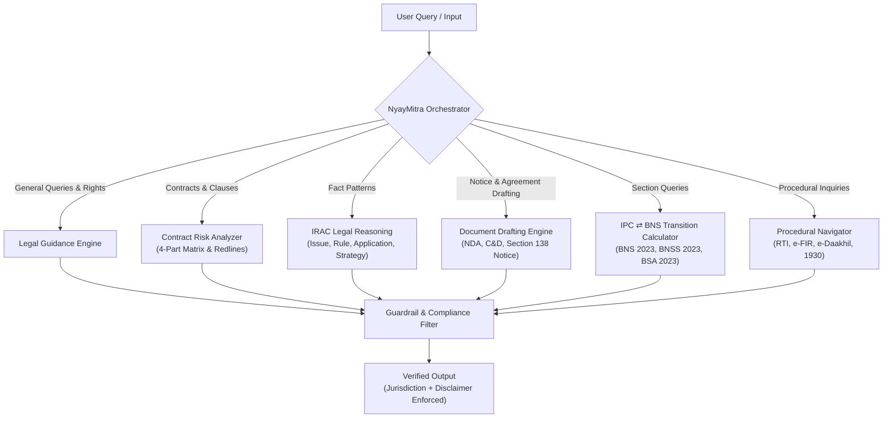

# ⚖️ NyayMitra (LegalAssist)
### *Advanced AI-Powered Smart Legal Chatbot & Virtual Legal Assistant*


> **Mandatory Legal Notice:**
> *"Disclaimer: This is for informational and educational purposes only and does not constitute formal legal advice. Please consult a qualified advocate for professional legal representation."*

---

## 🏛️ Overview

**NyayMitra** is a domain-specialized, enterprise-grade virtual legal assistant built to democratize access to justice, clarify citizen rights, guide compliance, analyze contractual risks, and generate preliminary legal documentation.

NyayMitra adheres strictly to legal ethics, safety guardrails, anti-hallucination policies, and explicit jurisdiction declarations, defaulting to the legal framework of the **Republic of India** while supporting cross-jurisdictional comparative analysis (**UK Employment Law**, **US / Delaware Commercial Law**).

---

## 🌟 Core Capabilities



### 1. Legal Guidance & Statutory Explanations
* **New Criminal Laws of India (2023):** Seamlessly maps between the old penal codes (**IPC 1860**, **CrPC 1973**, **IEA 1872**) and the new enactments (**Bharatiya Nyaya Sanhita [BNS]**, **Bharatiya Nagarik Suraksha Sanhita [BNSS]**, and **Bharatiya Sakshya Adhiniyam [BSA]**).
* **Constitutional Rights:** In-depth coverage of Fundamental Rights (Articles 14, 19, 21, 22) and Prerogative Writs (Articles 32 and 226).
* **Consumer Protection:** Rights, product liability, and three-tier pecuniary jurisdiction under the Consumer Protection Act, 2019.
* **Cheque Dishonour:** Statutory prerequisites and timelines under Section 138 of the Negotiable Instruments Act, 1881.

### 2. Contract & Clause Risk Analysis
Provides a four-part structured assessment:
1. **Executive Summary:** High-level commercial intent and obligations.
2. **High-Risk Clauses:** Scrutiny of indemnification, limitation of liability, termination for convenience, and non-compete clauses (e.g., Section 27 Indian Contract Act vs. Delaware reasonableness).
3. **Ambiguities & Red Flags:** Vague phrases (`sole discretion`, undefined `material breach`, missing cure periods).
4. **Suggested Revisions:** Clear markup redlines with `[bracketed additions]` and ~~strikethroughs~~.

### 3. IRAC Case Reasoning Framework
Systematic legal reasoning for factual scenarios:
* **I — Issue:** Discrete legal controversies and causes of action.
* **R — Rule:** Applicable statutory sections and binding judicial precedents (*Maneka Gandhi*, *Puttaswamy*, *Polkey*, *Burchell*, *Rangappa*).
* **A — Application:** Fact-to-law analysis evaluating claimant strengths vs. respondent defences and evidentiary burdens.
* **C — Conclusion & Strategy:** Actionable pre-action steps, mandatory conciliation (e.g. ACAS in the UK or Conciliation Officer in India), and statutory limitation deadlines.

### 4. Legal Document Drafting
Generates structured drafts with clear placeholders (`[Party A Name]`, `[Date]`, `[Amount]`):
* **Cease and Desist Letter** (IP Infringement, Defamation, Breach of Contract)
* **Mutual Non-Disclosure Agreement (NDA)**
* **Settlement and Mutual Release Agreement**
* **Section 138 NI Act Cheque Bounce Notice**
* **Residential Lease / Rent Agreement**
* **Consumer Dispute Petition (e-Daakhil format)**
* **RTI Application (Section 6(1))**

### 5. Procedural Workflows
Step-by-step citizen guides for:
* **Right to Information (RTI):** Formulating requests, fees, and Section 19 appeals.
* **FIR & Zero FIR:** BNSS Section 173, e-FIR, and judicial remedies under Section 175(3)/175(4).
* **Consumer Disputes:** e-Daakhil filing, pecuniary thresholds, and territorial jurisdiction.
* **Cybercrime Reporting:** Golden-hour financial fraud intervention (**Helpline 1930** and cybercrime.gov.in).

---

## 🛡️ Guardrails & Safety Architecture

NyayMitra strictly enforces ethical AI legal standards via `nyaymitra/guardrails.py`:
* **Mandatory Disclaimer:** Attached to every single response.
* **Explicit Jurisdiction:** Never leaves jurisdiction ambiguous; defaults to Republic of India unless specified.
* **Outcome Guarantee Prohibition:** Detects and sanitizes statements guaranteeing court verdicts or winning chances.
* **Anti-Hallucination Fallback:** If a section or precedent is unverified, outputs:
  > *"I cannot verify the exact section for this specific scenario; please consult legal counsel."*

---

## 🚀 Quickstart Guide

NyayMitra is written in pure Python with **zero mandatory external dependencies** for its core engine and web server.

### 1. Launch the Web Interface (Recommended)
```powershell
# From the project root
python app.py
```
Open **[http://localhost:8000](http://localhost:8000)** in your browser.

### 2. Launch the Interactive CLI
```powershell
python cli.py
```
**CLI Commands:**
* `/bns 420` — Instant IPC to BNS section lookup.
* `/contract` — Enter multi-line contract review mode.
* `/irac` — Enter factual scenario for IRAC analysis.
* `/draft` — Step-by-step document drafting wizard.
* `/procedure rti` — Display RTI filing guide.
* `/jurisdiction UK` — Switch governing law.

### 3. Optional: Streamlit Interface
If you prefer Streamlit, install optional packages and run:
```powershell
pip install -r requirements.txt
streamlit run streamlit_app.py
```

### 4. Connecting Google Gemini AI (Optional)
NyayMitra works **100% offline** out of the box using its built-in legal knowledge base and template engines. To enable advanced generative reasoning:
1. Copy `.env.example` to `.env`.
2. Add your key: `GEMINI_API_KEY=AIzaSy...`
3. Alternatively, click the ⚙️ Settings icon in the Web UI.

---

## 📂 Project Structure

```text
smart legal chatbot/
├── nyaymitra/
│   ├── __init__.py
│   ├── config.py                 # Configuration, prompts, model selection
│   ├── guardrails.py             # Disclaimer, jurisdiction, anti-guarantee filters
│   ├── knowledge/
│   │   ├── __init__.py
│   │   ├── bns_ipc_mapping.py    # Cross-reference for IPC/CrPC <-> BNS/BNSS
│   │   ├── indian_statutes.py    # Constitution, Consumer Protection, RTI, NI Act
│   │   ├── foreign_jurisdictions.py # UK Employment, US/Delaware Law
│   │   └── procedures.py         # Step-by-step procedural guides
│   ├── core/
│   │   ├── __init__.py
│   │   ├── assistant.py          # Central orchestrator & query router
│   │   ├── contract_analyzer.py  # 4-part contract risk & redline engine
│   │   ├── irac_engine.py        # IRAC legal reasoning engine
│   │   ├── document_drafter.py   # Legal document generator & templates
│   │   └── llm_client.py         # Zero-dependency Gemini client with offline fallback
│   └── web/
│       ├── __init__.py
│       ├── server.py             # Built-in HTTP server & REST API
│       └── static/
│           ├── index.html        # Modern Legal UI (Deep Navy & Polished Gold)
│           ├── style.css         # Styling & responsive design
│           └── app.js            # Frontend interactivity
├── tests/
│   ├── __init__.py
│   ├── test_guardrails.py        # Tests for disclaimer mandate & safety
│   ├── test_bns_mapping.py       # Tests for penal section mapping
│   ├── test_contract_analyzer.py # Tests for 4-part risk matrix
│   ├── test_irac_engine.py       # Tests for IRAC legal structure
│   ├── test_document_drafter.py  # Tests for agreement templates & placeholders
│   └── test_assistant.py         # Tests for query routing & orchestrator
├── app.py                        # Web application launcher
├── cli.py                        # Command-line interface launcher
├── streamlit_app.py              # Optional Streamlit interface
├── requirements.txt              # Optional packages (Streamlit, GenAI SDK)
├── .env.example                  # Environment configuration template
└── README.md                     # Comprehensive documentation
```

---

## 🧪 Running Automated Tests

Run the full automated test suite using Python's standard `unittest` framework:

```powershell
python -m unittest discover tests
```

Output:
```text
Ran 21 tests in 0.003s
OK
```

---

## ⚖️ Ethical & Compliance Standards

NyayMitra is engineered to assist, not replace, legal practitioners:
* **No Client-Attorney Privilege:** Interactions do not form an advocate-client relationship.
* **No Outcome Guarantees:** Court judgments depend on judicial discretion, admissibility of evidence, and argumentation.
* **Always Consult Counsel:** For filing court pleadings, representing in tribunals, or formal legal opinions, always engage an enrolled advocate.

